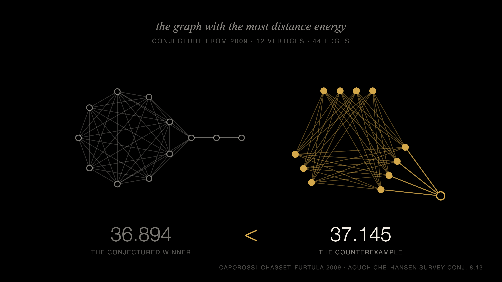
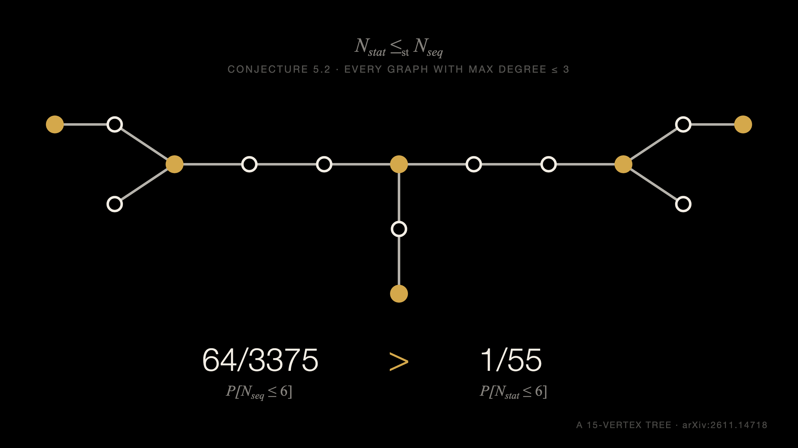
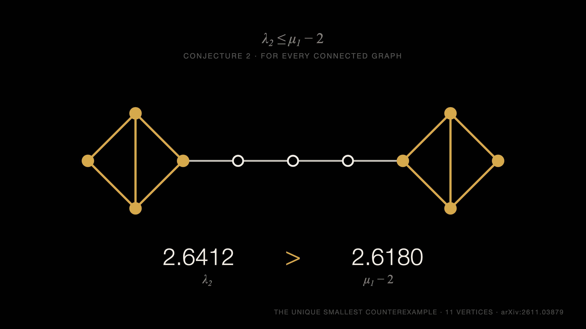
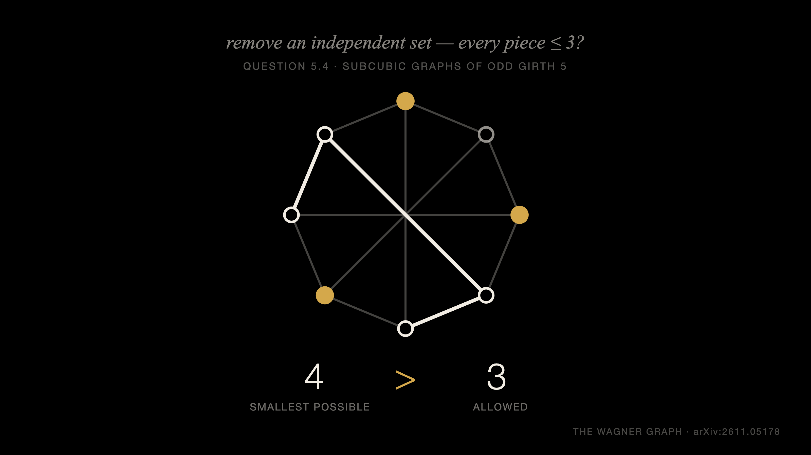

# Broken conjectures

This repository collects counterexamples to open mathematical conjectures, found by Claude agents in November 2026. Each result has its own folder with a verifier, and every verifier runs on plain Python with no packages and checks the counterexample in exact arithmetic.

```
python3 verify_all.py
```

Results 1 to 4 and result 6 (part 1) are also proved in Lean 4 with Mathlib, in [lean/](lean/). Each Lean statement is the conjecture in its general form, and each proof uses only Lean's three standard axioms. Result 5 and part 2 of result 6 are checked in Python only.

| | Conjecture | Source | Counterexample |
|---|---|---|---|
| 1 | [For m ≤ (n−2)(n−3)/2, a clique with a path appended maximises distance energy](conjectures/distance-energy-2009/) | Caporossi, Chasset, Furtula 2009, Conj. 4; Aouchiche–Hansen survey 2014, Conj. 8.13 | 12 vertices, 44 edges |
| 2 | [Random sequential adsorption dominates the uniform jammed ensemble on every graph of max degree ≤ 3](conjectures/rsa-jamming-2611.14718/) | Higuita-Diaz, López, Roldán-Correa, [arXiv:2611.14718](https://arxiv.org/abs/2611.14718), Conj. 5.2 | a 15-vertex tree |
| 3 | [λ₂(A) ≤ μ₁(L) − 2 for every connected graph](conjectures/cazenave-conjecture-2/) | Cazenave, [arXiv:2611.03879](https://arxiv.org/abs/2611.03879), Conj. 2 | 11 vertices, the unique smallest |
| 4 | [Question: does every subcubic graph of odd girth 5 split into an independent set and pieces of order ≤ 3?](conjectures/hausmann-question-5.4/) | Hausmann, [arXiv:2611.05178](https://arxiv.org/abs/2611.05178), Question 5.4 | the Wagner graph: the answer is no |
| 5 | [Five more statements marked open in Cazenave's conjecture corpus](conjectures/cazenave-archive-5/) | archive of arXiv:2611.03879 | 10 to 15 vertices |
| 6 | [11-adic congruences for (−q;q)ᵃ/(q;q) and (−q;q)ᵃ/(q;q)⁵ on X₀(22), both parts](conjectures/eleven-adic-2611.09681/) | Banerjee, Smoot, [arXiv:2611.09681](https://arxiv.org/abs/2611.09681), Conj. 6.1 | a = 36 and a = 40: the coefficient of q⁵⁴ has only one factor 11 |

<p>
 
 
</p>

## How they were found

Two Claude agents worked in parallel. Both were told to check the literature before attacking a statement and to verify every hit exactly.

- **The list hunter** took about 30 open conjectures from automated-conjecture lists and surveys:
  - Written on the Wall II;
  - TxGraffiti;
  - AutoGraphiX-era surveys;
  - Cazenave's 2026 corpus.

  It searched every graph up to 10 vertices (Brendan McKay's graph lists), structured families, and larger graphs by simulated annealing. It found results 1, 3 and 5.
- **The arXiv reader** went through every paper submitted between 26 Oct and 25 Nov 2026 in math.CO, math.NT, cs.DM and math.PR, 3,128 papers in all.
  - It found 247 conjectures and open questions posed for the first time and 217 restated ones. 159 of those still open looked checkable by computer.
  - It has attacked more than 20 of them so far, which gave results 2, 4 and 6. It also found result 3 again, on its own.
  - The counts come from language-model readers of abstracts and full texts and are accurate to roughly ±10%. The verdicts are exact.

## Status

- **Unrefereed.** Nothing here is peer reviewed, and we claim no priority.
- **Openness.** Each folder says how we checked that the statement was still open: the paper's versions, newer papers, the web, and the AI Village Graffiti tracker. A refutation we missed is possible; if you know one, please open an issue.
- **Credit.** The conjectures and the questions belong to their authors.
- **No floating-point eigenvalues.** They are bracketed with Sylvester's law of inertia over the rationals.

## License

MIT
