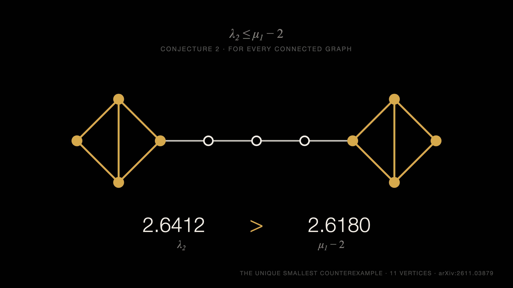

# λ₂(A) ≤ μ₁(L) − 2 is false: Conjecture 2 of arXiv:2611.03879

**Conjecture** (T. Cazenave, *Lemmas and Conjectures in Spectral Graph Theory*, [arXiv:2611.03879](https://arxiv.org/abs/2611.03879), 2 Nov 2026, Section 7, "the unrefuted conjectures that we find most interesting", Conjecture 2, corpus id #20829):

> For every connected graph, λ₂ ≤ μ₁ − 2.

Here λ₂ is the second largest eigenvalue of the adjacency matrix, counted with multiplicity, and μ₁ is the largest eigenvalue of the Laplacian. The statement comes from an automatically generated corpus of 305,755 conjectures (Duhamel and Cazenave). The paper tested it on all connected graphs with at most 9 vertices.

**Counterexample.** Two diamonds (K₄ minus an edge) whose degree-2 tips are joined by a path with 3 inner vertices. This gives n = 11 and m = 14, graph6 `J^_GGC??WB_`.

λ₂ = 2.641186… > μ₁ − 2 = 2.618034…  (μ₁ = (7 + √5)/2)

Why it breaks:
- The two diamonds are far apart, so they "ring" almost independently, and the second adjacency eigenvalue climbs almost to the first.
- No vertex has more than 3 neighbours, so the largest Laplacian eigenvalue stays low.

**It is the unique smallest counterexample.**
- All 11,716,571 connected graphs on 10 vertices satisfy the conjecture; the smallest slack is 0.037.
- An exhaustive search of 11-vertex graphs finds only this one. Every 11-vertex graph is a one-vertex extension of a 10-vertex graph, and eigenvalue interlacing prunes most of them.

**An infinite family.** Let G(k, L) be two copies of K_k − e joined at their missing-edge endpoints by a path with L inner vertices.
- G(k, L) breaks the conjecture for k = 4 with L ≥ 3, for k = 5 with L ≥ 2, and for k = 6..8 with L ≥ 1. All cases with k ≤ 8 and L ≤ 6 were checked exactly.
- For every k ≥ 6, G(k, 1) is a counterexample, by a computer-assisted proof.
- The violation grows with k.

**Was it open?**
- The author's archive (`index_conjectures.csv`, 31 Oct 2026) lists it as "ouverte" with no counterexample.
- arXiv has only version 1.
- We found no refutation on the web, on GitHub, or in the AI Village tracker.

**Verify.** Run `python3 verify.py`. It uses the standard library only. Eigenvalues are bracketed exactly with Sylvester inertia over the rationals. The script checks the graph built from the description above, the graph6 string, and seven members of the family.
