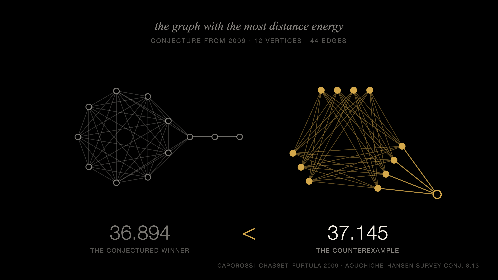

# Distance energy: the 2009 path-complete conjecture is false

**Conjecture** (Caporossi, Chasset, Furtula, *Some conjectures and properties on distance energy*, [Les Cahiers du GERAD G-2009-64](https://www.gerad.ca/papers/G-2009-64.pdf), Conjecture 4; restated as open in Aouchiche and Hansen, *Distance spectra of graphs: a survey*, Linear Algebra Appl. 458 (2014), Conjecture 8.13):

> Let G be a graph on n vertices and m ≤ (n − 2)(n − 3)/2 edges [that maximises distance energy], then G is composed of a path appended to a clique with possibly some edges between vertices of the clique and the vertex of the path adjacent to the clique.

The distance energy is E_D(G) = Σ |eigenvalues of the distance matrix|. For given n and m there is exactly one such path-complete graph PK(n, m): a clique K_k, a path on the remaining vertices, and the path vertex next to the clique joined to j clique vertices.

**Counterexample.** n = 12, m = 44, inside the range (the limit is 45). Take the complete tripartite graph K₄,₄,₃ and add one vertex joined to the four vertices of one of its 4-parts.

- graph6: `K]Nxnsor}^^R`
- E_D = 37.144682…, while PK(12, 44) = K₉ plus a 3-vertex path whose first vertex is joined to 6 clique vertices has E_D = 36.894239….

More counterexamples in the range, also checked by `verify.py`:

| n | m | graph6 | E_D | E_D(PK) |
|---|---|---|---|---|
| 12 | 45 | `K}ktb\|y]e^x}` | 36.703929 | 35.689228 |
| 13 | 54 | `LNzq\|snwyzdzmn` | 39.669579 | 39.242050 |
| 13 | 55 | `L^vimjjyp~\|XN\|` | 40.134560 | 38.013252 |

At n = 16 simulated annealing beats PK by up to 3.56.

**What we checked.**
- All graphs with n ≤ 10 satisfy the conjecture inside its range.
- n = 11 was searched by annealing but not exhaustively, so a smaller counterexample may exist.
- The original 2009 study found its maximisers with the AutoGraphiX heuristic for 12 ≤ n ≤ 30. These dense, diameter-2 graphs were missed.

**Was it open?** We found no refutation on arXiv, the web, or the AI Village Graffiti tracker, which has no distance-energy entries. If you know one, please open an issue.

**Lean.** [`DistanceEnergy.conjecture_false`](../../lean/Conjectures/DistanceEnergy.lean) refutes the conjecture as worded. It is checked with Lean v4.36.0 and Mathlib v4.36.0, and uses only the axioms `propext`, `Classical.choice` and `Quot.sound`.

**Verify.** Run `python3 verify.py`. It uses the standard library only and computes no floating-point eigenvalues: every positive eigenvalue of the distance matrix is bracketed exactly with Sylvester inertia over the rationals.
