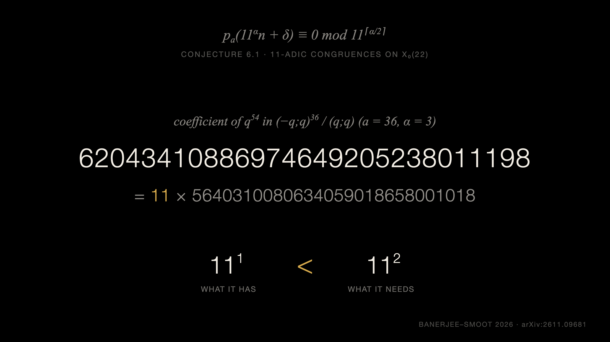

# 11-adic congruences on X₀(22): Conjecture 6.1 of arXiv:2611.09681 is false

**Conjecture** (K. Banerjee and N. A. Smoot, *On a Problem of Gordon and Hughes: The 11-adic Properties of Meromorphic Modular Functions on X₀(22)*, [arXiv:2611.09681](https://arxiv.org/abs/2611.09681), 6 Nov 2026, Conjecture 6.1).

For a ∈ ℤ, let

Σ p⁽¹⁾ₐ(n) qⁿ = (−q;q)∞ᵃ / (q;q)∞  and  Σ p⁽²⁾ₐ(n) qⁿ = (−q;q)∞ᵃ / (q;q)∞⁵.

Let α ∈ ℕ and n ∈ ℕ₀. The conjecture has two parts:

1. If a ≡ 3, 5, 7 (mod 11), then p⁽¹⁾ₐ(11^α n + δ) ≡ 0 (mod 11^⌈α/2⌉), where 24δ ≡ 1 − a (mod 11^α).
2. If a ≢ 1, 3, 5 (mod 11), then p⁽²⁾ₐ(11^α n + δ) ≡ 0 (mod 11^⌈α/2⌉), where 24δ ≡ 5 − a (mod 11^α).

**Counterexamples.** Take α = 3 and n = 0. Then δ = 54, since 24 · 54 = 1296 ≡ −35 (mod 1331), and the coefficient must be divisible by 11² = 121.

| part | a | coefficient at q⁵⁴ | 11-adic valuation |
|---|---|---|---|
| (1) | 36 ≡ 3 | 62043410886974649205238011198 = 11 × 5640310080634059018658001018 | 1 |
| (2) | 40 ≡ 7 | 66134580699742235651549220246110 | 1 |

Both are divisible by 11 but not by 121.

**Where it fails.** Many values of a satisfy the conjecture. Among a ∈ [−40, 60] with α ≤ 3, it fails at α = 3 only for these:
- part (1): a = 36, 47, 58, 60, −37;
- part (2): a = 51 (and a = 40 above).

So the conjecture holds for small a but is false as stated, for all a in the given residue classes. n = 1 fails as well: for part (1) with a = 36, that is index 1385.

**Was it open?** The paper has only version 1 (6 Nov 2026), and we found no refutation. The paper proves the case a = 2 of part (2) as its Theorem 1.1, and our code reproduces that case (see the control in `verify.py`).

**Verify.** Run `python3 verify.py`. It uses the standard library only and computes exact integer coefficients of the products, without any modular reduction.
