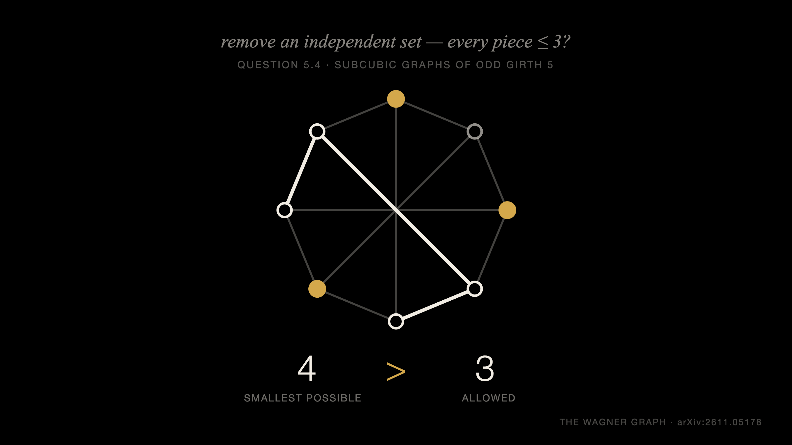

# Question 5.4 of arXiv:2611.05178 has answer "no": the Wagner graph

**Question** (W. Hausmann, *Weighted Max Cut in Subcubic Graphs*, [arXiv:2611.05178](https://arxiv.org/abs/2611.05178), 3 Nov 2026, Question 5.4):

> Does every subcubic graph G of odd girth exactly five admit a partition V(G) = L ∪ R such that L is independent and every component of G[R] has order at most three?

The paper notes that a "yes" would give the weighted 4/5 max-cut conjecture of Gutin and Yeo for this odd-girth class.

**Answer: no.** The Wagner graph V₈ (an 8-cycle plus its four long diagonals) is cubic and triangle-free, with odd girth 5. For every independent set L, the graph V₈ − L has a component with at least 4 vertices. The best choice, L = {0, 2, 5} (gold in the picture), leaves {1} and the 4-vertex path 4–3–7–6.

V₈ is the smallest counterexample. There are 7 more on 10 to 13 vertices.

This is an open question rather than a conjecture, and the 4/5 conjecture itself survives. Its minimum over all non-bipartite triangle-free cubic graphs on up to 12 vertices is exactly 4/5, and V₈ attains it. Question 5.5 (odd girth ≥ 7, pieces of order ≤ 5) also holds on all triangle-free subcubic graphs up to 13 vertices.

**Verify.** Run `python3 verify.py`. It uses the standard library only and does a brute force over all 256 vertex subsets.
