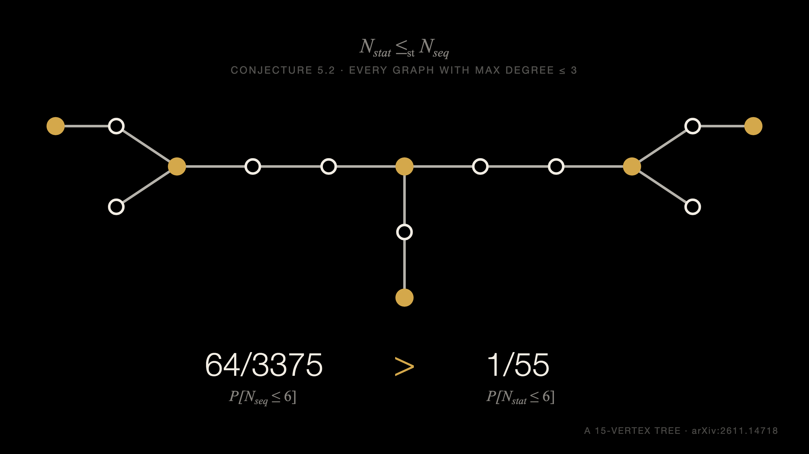

# Random sequential adsorption vs. uniform jamming: Conjecture 5.2 of arXiv:2611.14718 is false



**Conjecture** (Higuita-Diaz, López, Roldán-Correa, *Random Sequential Adsorption versus the Uniform Ensemble of Jammed Configurations: Stochastic Dominance on Graphs*, [arXiv:2611.14718](https://arxiv.org/abs/2611.14718), v1 10 Nov 2026, v2 18 Nov 2026, Conjecture 5.2):

> For every finite simple graph G with maximum degree Δ(G) ≤ 3, the sequential model dominates the static model (N_stat ≤st N_seq).

The two models are defined as follows:
- **Sequential.** Vertices are occupied one at a time, each chosen uniformly among the still-available vertices, and an occupied vertex blocks its neighbours. The process stops when the graph is jammed.
- **Static.** A maximal independent set is chosen uniformly at random.

Dominance means P[N_seq ≤ k] ≤ P[N_stat ≤ k] for every k (the paper's Definition 2.1). The authors checked all connected graphs with Δ ≤ 3 on up to 12 vertices.

**Counterexample.** A tree with 15 vertices and maximum degree 3:

```
0-1 0-2 0-3 1-4 2-5 3-6 4-7 5-8 7-9 7-10 8-11 8-12 9-13 11-14
```

It has 55 maximal independent sets: one of size 6, `{0, 6, 7, 8, 13, 14}` (gold in the picture), 50 of size 7 and 4 of size 8. At k = 6:

P[N_seq ≤ 6] = 64/3375 ≈ 0.018963 > 1/55 ≈ 0.018182 = P[N_stat ≤ 6].

At k = 7 the inequality goes the other way, so on this tree neither model dominates the other.

**What we checked.**
- All 358,891 connected graphs with Δ ≤ 3 on up to 14 vertices satisfy the conjecture (the authors checked up to 12), so 15 vertices is the smallest possible size.
- A second counterexample, also a tree, has 20 vertices.
- Our code reproduces the paper's own numbers: its Figure 5, the counts in its Observation 5.1, and its count of 27,525 graphs.

**Was it open?** Version 2 of the paper (18 Nov 2026) still states the conjecture, and we found no refutation.

**Verify.** Run `python3 verify.py`. It uses exact fractions and the standard library only, and takes about a second. The static law is computed by brute force over all 2¹⁵ vertex subsets, and the sequential law by recursion over the sets of still-available vertices.

**Lean.** [`RSA.conjecture52_false`](../../lean/Conjectures/RSA.lean) refutes the conjecture as worded. It is checked with Lean v4.36.0 and Mathlib v4.36.0, and uses only the axioms `propext`, `Classical.choice` and `Quot.sound`. Lean proves the two inequalities P[N_seq ≤ 6] ≥ 64/3375 and P[N_stat ≤ 6] ≤ 1/55, which is all the refutation needs.
